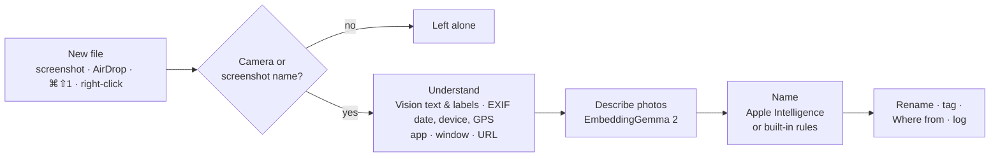

<div align="center">


# LabelIt

**Screenshots and phone photos, named for what's in them.**

A small macOS menu bar app that turns `Screenshot 2026-11-08 at 10.41.07.png` and `IMG_4821.HEIC`
into names you can find later. The AI runs entirely on your Mac.

[](LICENSE)


</div>

| Before | After |
|---|---|
| `Screenshot 2026-11-08 at 10.41.07.png` | `stripe-checkout-payment-declined_2026-11-08_104107.png` |
| `IMG_4821.HEIC` + `IMG_4821.MOV` (a Live Photo) | `dog-beach-sunset_lisbon_2026-11-02.heic` + `.mov` |
| `IMG_6561.PNG` (an AirDropped iPhone screenshot) | `content-privacy-restrictions_2026-10-05.png` |
| `IMG_2210.HEIC` (a photo of a receipt) | `receipt-blue-bottle-9-75_2026-11-02.heic` |
| `unnamed.jpg` (right-click → Rename with LabelIt) | `office-portrait_2026-11-09.jpg` |

---

## Why

macOS names every screenshot after the moment it was taken, and every photo you AirDrop from your
iPhone arrives as `IMG_` plus a number. A week later, Downloads and Desktop are full of names that say
nothing. Spotlight can't find "that Stripe error" when the file is called
`Screenshot 2026-11-08 at 10.41.07`.

LabelIt watches for those files and gives each one a short, descriptive name as soon as it lands. It
has no library to import into, no account and no cloud.

## Features

- 📸 **macOS screenshots** (⌘⇧3 / ⌘⇧4 / ⌘⇧5): named from what's on screen, such as the page title,
  the error message, or a receipt's merchant and total.
- 📱 **Files from your iPhone or iPad** (AirDrop, Continuity Camera, Image Capture) in Downloads,
  Desktop and Pictures, or any folders you choose in Settings. They're named for what the photo shows and dated by when it was *taken*, not
  when it was transferred. The city is optional. A Live Photo's image and video get the same name.
- 🖱️ **Right-click any image, video or PDF** in Finder → **Rename with LabelIt**. Works on browser
  downloads, Slack and Messages images, anything. A PDF is named for what it is and its subject, from its
  title or first page: `UC-23a39ce3-….pdf` → `udemy-certificate-building-modern-web-applications_2021-12-28.pdf`.
- ⌨️ **⌘⇧1 capture** takes a screenshot and records *where it came from* (the app, the window and the
  web page) in the file's "Where from" field. Finder's Get Info and Spotlight both show it.
- 🗂️ **Label past files**: see the proposed names first, then rename the phone files that piled up
  before you installed LabelIt.
- 🏷️ **Finder tags** for each kind of file: Screenshot, Error, UI, Receipt, Document, Photo, Video.
- ↩️ **Undo** any rename from the menu bar.

## Private by design

Everything happens on your Mac.

| | |
|---|---|
| Text in screenshots | Apple **Vision**, on-device |
| What a photo shows | **EmbeddingGemma 2** (Google DeepMind, open weights) via llama.cpp on your GPU |
| Writing the name | **Apple Intelligence** (Foundation Models), on-device, or built-in rules |
| Network | None, except two things you choose: the one-time model download and the optional city lookup (Apple's location service) |

LabelIt never uploads a file, never touches your Photos library, and has no analytics.

## Safe by default

An app that renames files you didn't ask it to rename loses your trust fast, so LabelIt is careful:

- **Only camera and screenshot names.** On its own, LabelIt renames only files with names like
  `IMG_4821`, `PXL_…` or `Screenshot …`, or the random IDs apps give the files they save
  (`52b527bd220042f6bf013e0356aeac67.MP4`). It never touches a file someone named on purpose
  (`passport-scan.jpg`), unless you choose it yourself with *Rename with LabelIt*.
- **Only new files.** The watchers ignore anything older than 15 minutes. Older files are renamed only
  through *Label past files*, which shows every new name before renaming.
- **Waits for downloads to finish.** A file's size has to stop changing first, and `.download` and
  `.crdownload` files are skipped.
- **Never renames twice.** A small extended attribute marks each renamed file, and it travels with the
  file.
- **Never overwrites.** If a name is taken, LabelIt adds `-2`, `-3` and so on.
- **Everything can be undone.** Each rename is logged in
  `~/Library/Application Support/LabelIt/history.json`.

## How it works



Files you pick with right-click skip the name check: choosing a file counts as asking for it to be
renamed.

**Screens** (screenshots and other screen grabs) are named from their text. LabelIt uses the window
title, the screen's heading (skipping a phone's status bar), an error line, or a receipt's merchant and
total.

**Photos** are described by **EmbeddingGemma 2**, which places images and text in the same space.
LabelIt compares each photo with about 240 phrases (`a photo of a dog`, `a photo taken at sunset`…) in
three groups: subject, setting and light. A group's best match is used only when it clearly stands out
from the rest. That's what turns `photo` into `living-room`:

| Photo | Vision alone | With EmbeddingGemma 2 |
|---|---|---|
| a car wheel | `wheel-tire` | `car-wheel` |
| a laptop on a desk | `photo` | `laptop` |
| a living room | `photo` | `living-room` |
| a garden on a sunny day | `photo` | `garden-sunny` |

**Apple Intelligence**, when it's turned on, writes the final name from all of that. Without it, the
built-in rules write the name.

Names follow one pattern: `what_[city_]date[_time].ext`. They're lowercase and hyphenated. Letters from
any language are kept, and duplicate words and random IDs are dropped.

## Install

Paste this into Terminal (Applications → Utilities → Terminal):

```sh
curl -fsSL https://raw.githubusercontent.com/arifamir/labelit/main/install.sh | bash
```

It downloads the latest release, checks it against its SHA-256, puts LabelIt in Applications and opens it.
[Read the script](install.sh) first if you like; it's short. Run the same line again to update, or add
`-s -- --uninstall` after `bash` to remove LabelIt.

**You'll need** a Mac with Apple Silicon running **macOS 26**.

A tag icon appears in the menu bar near the clock, and a short welcome window walks you through the rest.
LabelIt has no Dock icon: open it again (from Applications or Spotlight) at any time to bring its window back.

> **Can't see the icon?** On a MacBook with a notch, menu bar icons that don't fit hide behind it. Hold ⌘ and
> drag other icons out of the menu bar to make room.

**Optional, for better names:**

- **EmbeddingGemma 2**: go to *Settings → Naming → Download*. It's 865 MB, and the files are checked
  against pinned SHA-256 hashes. If you already use [DigUp](https://github.com/ARahim3/DigUp), LabelIt
  reuses its copy and skips the download.
- **Apple Intelligence**: turn it on in *System Settings → Apple Intelligence & Siri*.

### Build from source

With **Xcode 26**, [XcodeGen](https://github.com/yonaskolb/XcodeGen) and CMake (`brew install xcodegen cmake`):

```sh
make install                 # builds LabelIt.app and copies it to /Applications
```

`make release` packages `dist/LabelIt.zip` and its checksum for a GitHub release, the files the install line
downloads. With a Developer ID certificate in the keychain it's signed for distribution, and with
`NOTARY_PROFILE` set also notarized (see `scripts/release.sh`).

### Permissions

macOS asks for each of these once. If you decline one, only the feature that needs it stops working.

| Permission | Asked when | Used for |
|---|---|---|
| Screen Recording | First ⌘⇧1 capture | Window titles for the capture shortcut |
| Desktop, Downloads, Pictures | First rename in each folder | Renaming new files there |
| Automation (per browser) | First ⌘⇧1 capture in that browser | Recording the web page's address. You can turn this off in Settings |
| Notifications | First launch | "Screenshot labeled" banners. Optional |

> **Building it yourself?** An ad hoc signed build looks like a new app to macOS after every rebuild,
> so macOS asks for permissions again. To keep them across rebuilds, copy
> `Config/Local.xcconfig.example` to `Config/Local.xcconfig` and add your Apple Development team.

## Using it

| | |
|---|---|
| **Automatic** | Take screenshots and AirDrop photos as usual. LabelIt renames them within a couple of seconds. |
| **⌘⇧1** | Capture a region. It's named and saved along with its app, window and web page. |
| **Right-click** | Select images, videos or PDFs in Finder → **Rename with LabelIt** (near the bottom of the menu, or under *Services*). |
| **Menu bar** | Recent renames with Undo and Reveal in Finder, plus Pause, *Label past files…* and Settings. |
| **Folders** | *Settings → Sources*: add the folders your phone files land in, or remove any. LabelIt looks two folders deep in each. |

<details>
<summary><b>Command-line tool</b>: preview names, inspect a file, tune the vocabulary</summary>

```sh
make preview DIR=~/Downloads LIMIT=30   # dry run: what would LabelIt rename? Renames nothing.
swift run labelit-cli inspect <file>    # what Vision and the metadata reader see
swift run labelit-cli describe <file>…  # EmbeddingGemma 2's top matches and scores
```

</details>

## FAQ

<details>
<summary><b>Why wasn't my file renamed?</b></summary>

On their own, the watchers rename only *new* files (under 15 minutes old) with camera or screenshot
names. Phone files also have to be confirmed as coming from an iPhone or iPad, through AirDrop or
iPhone EXIF data. That's on purpose. For anything else, right-click → **Rename with LabelIt**.
</details>

<details>
<summary><b>Do I need Apple Intelligence?</b></summary>

No. Without it, built-in rules name files from the same information. With it, names read more naturally.
</details>

<details>
<summary><b>How much memory does it use?</b></summary>

Very little while idle. EmbeddingGemma 2 (about 1 GB) loads when a photo arrives, takes about 0.15
seconds per photo, and unloads after 90 seconds with no new photos.
</details>

<details>
<summary><b>Does it work with search apps?</b></summary>

That's the point. Good names and tags make Spotlight, Finder search and tools like
[DigUp](https://github.com/ARahim3/DigUp) work better. LabelIt names and organizes your files, and
leaves searching to those tools.
</details>

<details>
<summary><b>Windows? Linux? Intel Macs?</b></summary>

**Linux** has the engine and a command-line tool today ([see below](#linux-preview)); a tray app comes
next, then **Windows**. **Intel Macs** aren't supported: Apple Intelligence and LabelIt's Metal build of
llama.cpp need Apple Silicon.
</details>

<details>
<summary><b>How do I uninstall it?</b></summary>

Quit LabelIt from its menu and delete it from Applications. To remove everything:

```sh
rm -rf ~/Library/Application\ Support/LabelIt   # history, model download, caches
tccutil reset All com.kodberry.labelit          # permissions
```

Renamed files keep their new names. Undo them first if you want the old names back.
</details>

## Linux (preview)

LabelIt's engine runs on Linux, with a command-line tool. The same pipeline and safety rules apply; the
platform's own pieces stand in for Apple's:

| | macOS | Linux |
|---|---|---|
| Reading pictures | ImageIO | stb (JPEG, PNG), libheif (iPhone HEIC) |
| Dates, devices, places | ImageIO, AVFoundation | LabelIt's own reader (checked against Apple's on 443 real files) |
| Text in screenshots | Vision | Tesseract: English plus your system's language |
| What a photo shows | EmbeddingGemma 2 on the GPU | EmbeddingGemma 2 on the processor (same results, slower) |
| Writing the name | Apple Intelligence or rules | rules |
| Spotting phone files | AirDrop's record, iPhone EXIF | iPhone EXIF and iOS's screenshot marker |
| Spotting screenshots | macOS's marker | GNOME's and KDE's file names |
| Tags, "Where from" | Finder tags | `user.xdg.tags` (Dolphin shows them), `user.xdg.origin.url` |

Not on Linux yet: frames from videos (videos are named from their metadata), the ⌘⇧1 capture and city
names.

On Ubuntu 24.04 (what LabelIt is tested on), with [Swift 6.3](https://www.swift.org/install/linux/):

```sh
sudo apt install cmake ninja-build pkg-config libheif-dev libheif-plugin-libde265 \
                 libtesseract-dev tesseract-ocr-eng   # and tesseract-ocr-swe, -deu… for your language
scripts/build-llama.sh && swift build -c release
.build/release/labelit-cli status
```

```sh
labelit-cli preview ~/Pictures     # what it would rename; renames nothing
labelit-cli rename IMG_4821.HEIC   # rename these files now
labelit-cli watch [folder…]        # rename new screenshots and phone files (default: Downloads, Desktop, Pictures)
labelit-cli undo                   # put the last rename back
```

EmbeddingGemma 2 is found in `~/.local/share/LabelIt/Models` or the Hugging Face cache
(`huggingface-cli download ggml-org/embeddinggemma-2-GGUF embeddinggemma-2-Q8_0.gguf mmproj-embeddinggemma-2-Q8_0.gguf`).

## Development

```sh
make test      # unit and pipeline tests (Vision runs for real; the model test runs if the model is present)
make run       # build build/Release/LabelIt.app and open it
make project   # regenerate LabelIt.xcodeproj from project.yml, to work in Xcode
make linux-test   # build and test on Linux, in Docker (needs Docker; shares this Mac's model read-only)
```

```
Sources/LabelItCore/        the pipeline, in plain Swift: runs on every platform
  Labeler.swift               decide → understand → name → rename → tag → log
  Platform.swift              what a platform supplies: reading files, seeing pictures, places
  Namer.swift, NamingPrompt.swift  file kinds, rule-based names, what a language model is told
  MetadataParser.swift        EXIF, PNG and QuickTime metadata, without system frameworks
  ExtendedAttributes.swift    AirDrop detection, processed marker, Where from, tags
  RenameLog.swift             history and undo
Sources/LabelItPlatform/    each platform's pieces
  Apple/                      Vision, ImageIO, AVFoundation, Apple Intelligence, FSEvents
  Linux/                      stb, libheif, Tesseract, inotify
  Shared/                     NativePlatform (picks the pieces), the "finished arriving" check
Sources/LabelItEmbedding/   EmbeddingGemma 2 on llama.cpp: embedder, vocabulary, describer, download
Sources/CLlama*/            module maps for the static llama.cpp in Vendor/ (scripts/build-llama.sh)
Sources/labelit-cli/        preview, rename, watch, undo, inspect, describe
App/                        the SwiftUI menu bar app
Config/                     signing (ad hoc unless Config/Local.xcconfig says otherwise)
```

**Better photo names** usually come from the vocabulary. Add phrases to
[`Vocabulary.swift`](Sources/LabelItEmbedding/Vocabulary.swift) (their vectors are computed once and
cached), then check them on real photos with `labelit-cli describe`.

Contributions are welcome. For anything bigger than a fix, please open an issue first.

## Credits

- The EmbeddingGemma 2 runtime (`GemmaEmbedder.swift`, `scripts/build-llama.sh` and
  `scripts/llama.cpp-no-logits.patch`) is adapted from DigUp, MIT © 2026 Abdur Rahim.
- [llama.cpp](https://github.com/ggml-org/llama.cpp) (MIT) runs the model.
  [EmbeddingGemma 2](https://huggingface.co/google/embeddinggemma-2) is by Google DeepMind
  (Apache 2.0). It's downloaded separately and isn't shipped with LabelIt.

Third-party notices are in [`ThirdPartyLicenses/`](ThirdPartyLicenses) and inside the app.

## License

[MIT](LICENSE) © 2026 M. Arif Amir and Kodberry
